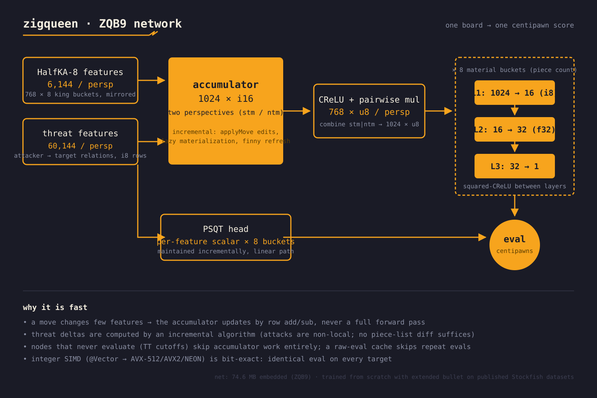
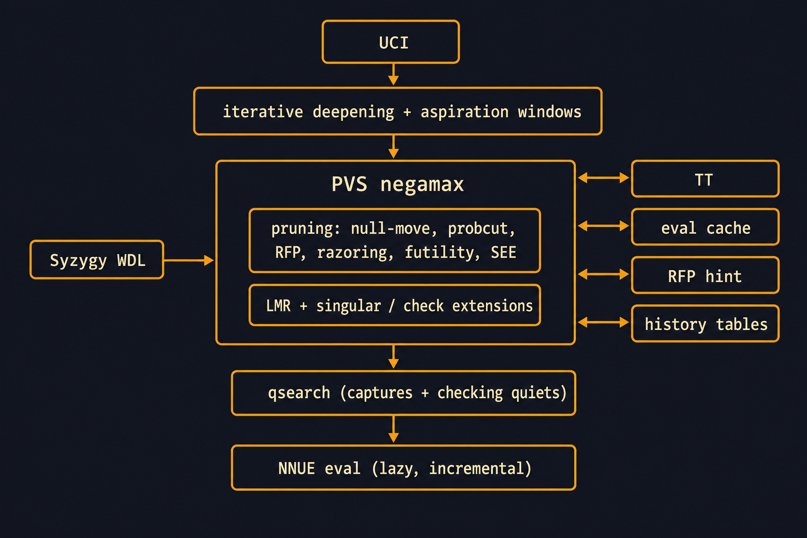

# zigqueen architecture

zigqueen is a UCI chess engine in Zig: a bitboard position model with
make/unmake, a pure NNUE evaluation with incrementally updated accumulators,
and a PVS search with iterative deepening on 1 to 32 threads (Lazy SMP).

## Module map

```
src/
  main.zig        UCI loop and diagnostic subcommands (bench, perft, stability, ...)
  core/           bitboards, squares, pieces, moves, Position/StateInfo, FEN, zobrist
  movegen/        magic attack tables, move generation with legality at the source,
                  make/unmake, perft
  eval/           NNUE inference (nnue768.zig), threat features (fullthreats.zig),
                  pawn pairs (pawnpairs.zig), embedded network
  search/         engine and search context, TT, eval cache, negamax and root,
                  quiescence, pruning and reductions, ordering, histories,
                  correction history, SEE, repetition, fifty-move rule, Syzygy
                  root policy, time management, tunables (-Dtuning builds only)
  tb/             Syzygy WDL/DTZ prober, written from docs/SYZYGY_FORMAT.md
  uci/            protocol, options, search workers
  tools/          offline diagnostics and data tools
  util/           huge-page allocation, shared read-only blobs
  tb_oracle.zig   test tool: checks src/tb against Fathom
deps/fathom/      Fathom (C, MIT), linked only into the test tool
```

Structural rules:

- No global mutable search state. Long-lived state (options, TT, histories,
  network) lives in `Engine`; per-search state (counters, stop control, stack,
  PV, repetition history) in `SearchContext`.
- `Position` holds placement, occupancies, mailbox, side, castling, en
  passant, clocks and hash; `StateInfo` holds the reversible per-ply data.
- No heap allocation in search, move generation, make/unmake or evaluation:
  move lists, the search stack and the history tables are fixed-size arrays.

## NNUE evaluation



The diagram predates the 16 king buckets and the pawn-pair block.

The network format is `ZQBA`; the 88.7 MB network is embedded
(`src/eval/default_net.zqb`), and `EvalFile` loads another. Layout and
training are in [NETWORK.md](NETWORK.md).

- **Inputs.** HalfKA with 16 king buckets per perspective, mirrored so the
  own king stands on files a–d (black's frame rank-flipped); 60,144 threat
  features (attacker, its square, victim, its square, for attacks under the
  current occupancy); 1,488 pawn-pair features.
- **Accumulator.** One 1024-wide half per perspective: i16 HalfKA rows plus
  i8 threat and pawn-pair rows, which depend on the mirror but not on the
  king bucket.
- **Readout.** Eight material buckets, each clipped-ReLU with pairwise
  multiply, `1024 → 16` (i8, VNNI or dot-product), squared clipped-ReLU,
  `16 → 32 → 1`, plus a PSQT head. `NNUE Scale Percent` (default 44) scales
  the output.
- **SIMD.** Portable `@Vector` code lowers to AVX-512, AVX2 or NEON, with a
  scalar fallback. The integer arithmetic is exact, so every target computes
  the same evaluation. The AVX-512 build runs the accumulator and activation
  kernels 512 bits wide.

Incremental updates:

- **One pass per move.** A move's HalfKA rows and its threat and pawn-pair
  rows are applied to the parent's half in one pass per perspective.
- **Threat deltas.** A move changes threat features far from its squares
  (discovered attacks). The added and removed features are found per changed
  square: pawns and knights only change their feature on that square;
  sliders are read in ray space, the board held as eight rays per square in
  vector registers, so the first blocker per ray and its attackers come from
  byte arithmetic. Pawn-pair rows change only when a pawn set changes.
- **Lazy materialization.** Updates are deferred until a node evaluates;
  nodes that cut off before a static eval skip them.
- **King moves.** A king move that changes the bucket syncs from a per-bucket
  refresh cache (diffed by mailbox); a move across the d/e files rebuilds the
  mirrored threat half from a flip cache.

## Search



Iterative deepening with aspiration windows around a PVS/negamax core; once
the window delta reaches its cap, the failing side opens fully.

- **Threads.** Every thread searches the same root with its own iterative
  deepening and shares only the transposition table; histories, eval cache,
  hint table and accumulators are private. Thread 0 owns the clock, the root
  tablebase decision, UCI output and the final move. Helpers are created on a
  `Threads` change and park between searches.
- **Transposition table.** Two 24-byte entries per cluster, depth-preferred
  with generations, prefetched at make time; entries keep the raw static
  eval. With more than one thread the clusters are 64 bytes with a sequence
  word: a writer claims the cluster with one compare-and-swap or skips the
  store, and a reader that sees a concurrent write treats it as a miss.
- **Eval cache.** Raw static evals of positions the TT evicted: 8-way sets of
  8-byte entries in one 64-byte line, sized at a quarter of `Hash` (4–64 MB).
- **Pruning and reductions.** Late-move reductions and the pruning families
  (null move with verification, reverse futility with a hint table,
  futility, late-move, history and SEE pruning) share one fractional
  depth-dose scheme ([PROVENANCE.md](PROVENANCE.md) §1); probcut and razoring
  sit beside it. Post-PV root moves are scouted at reduced depth.
- **Fail-soft cutoffs.** Reverse futility and the quiescence stand-pat return
  a value between beta and the static eval; null move returns its score.
- **Correction history.** Tables for pawn structure, each side's non-pawn
  pieces, minor pieces, major pieces and the last two moves learn how far
  the static eval misses. The corrected eval drives pruning, extensions and
  `improving`; the size of the correction widens the futility margins and
  shrinks reductions. The TT and eval cache keep the raw eval.
- **Extensions.** Singular; checks at shallow depth, deeper only when the
  static eval is at or below alpha.
- **Move ordering.** TT move, captures by SEE, killers, countermove, quiet
  history (four tables by attacked from/to squares), continuation history.
- **SEE.** A king captures only onto a square no longer attacked; a piece
  pinned to its own king does not capture off the pin line; promotions count.
- **Quiescence.** Captures and promotions, plus SEE-gated quiet checks at the
  first ply.
- **Fifty-move rule.** A node at halfmove clock 100 is a draw unless the side
  to move is mated; no TT cutoffs from clock 90 on.

## Tablebases

`src/tb` probes WDL tables in the search and DTZ tables at the root. Tables
are memory-mapped, with positioned reads as the fallback when mapping fails
or a finite address-space limit is reached. Probes take no lock: each search
holds a lease on an immutable table snapshot, and a `SyzygyPath` change swaps
in a new one. At a covered root, a DTZ probe of every legal move restricts
the search to the moves that keep the best result (respecting
`go searchmoves`); only a proven outcome replaces searched scores, the game's
repetitions count, and a win the fifty-move rule may turn into a draw ranks
below certain wins. Tablebase scores in the TT are relative to the node.

## Time management

The root is anytime: an interrupted iteration's best move counts once it is
proven against the previous one. Base time comes from the increment and the
clock above a reserve of about ten increments (cyclic controls use the moves
to go). A stop rule checked at root-move boundaries and node polls reacts to
fail-lows, best-move changes and score drops; extra time comes from the
reserve, up to a burst cap. `Move Overhead`, a cap at the remaining clock and
low-clock limits stay in force.

## Performance

- **Huge pages** for the TT, hint table, eval cache, histories, network
  weights and search context: `MAP_HUGETLB`, then THP via `madvise` on Linux;
  `MEM_LARGE_PAGES` on Windows when "Lock pages in memory" is granted.
- **Prefetching** of TT and hint-table entries for the child at make time.
- **Cache-line layouts** for TT clusters, eval-cache sets, accumulators and
  weights; the hottest functions are 64-byte aligned.
- **PGO.** The x86-64 release binaries are relinked from Zig's LTO bitcode
  with LLVM's context-sensitive PGO and a committed profile per variant
  (`scripts/pgo-build.sh`).
- **Exact output.** Performance changes must keep fixed-depth node counts
  and PVs identical at one thread, where the search is deterministic.

## Validation

- `zig build test`: perft, make/unmake and hash restoration, incremental
  against full-refresh accumulators, TT and eval-cache invariants, tablebase
  probing, UCI parsing.
- `zigqueen stability 5`: fixed-depth repeatability; `zigqueen bench`: a
  fixed-node signature.
- Strength changes: self-play SPRT and external gauntlets
  ([TUNING.md](TUNING.md), [QUALITY_GATES.md](QUALITY_GATES.md)).
